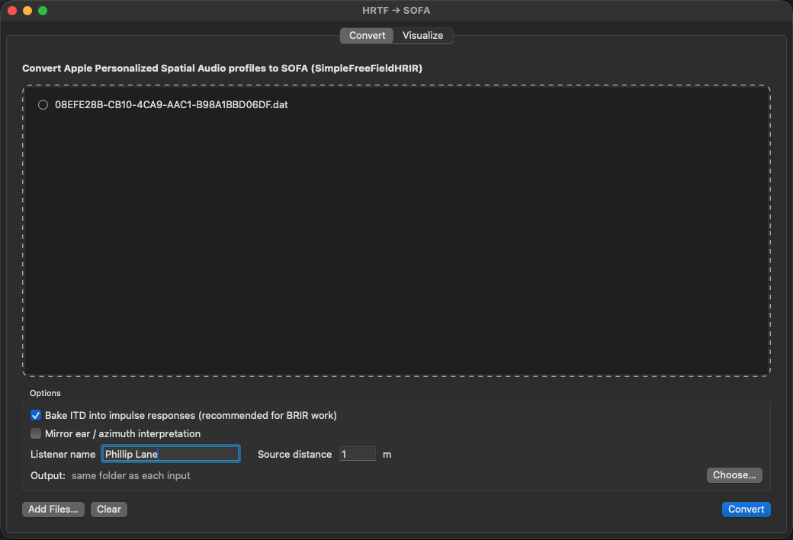
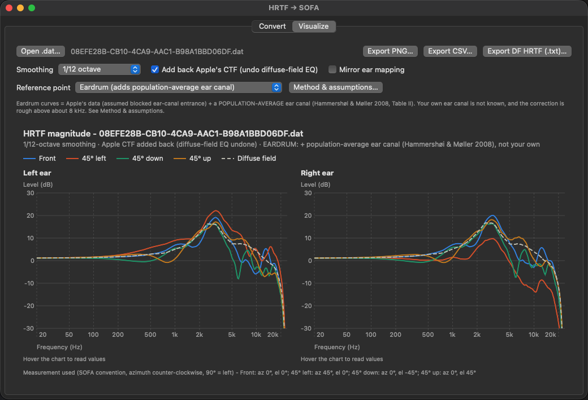

# Apple personalized spatial audio → SOFA

Converts the personalized HRTF that iOS builds from the TrueDepth ear scan
(the `.dat` files synced through iCloud; see below for where to find them) into SOFA
(AES69-2022, `SimpleFreeFieldHRIR` 1.0), so it can be used in any SOFA-aware binaural renderer
or for synthesizing BRIRs.

## Getting your .dat files

The personalized-audio profiles are stored on your Mac at:

```
~/Library/com.apple.bluetooth.services.cloud/CachedRecords/SoundProfileAsset
```

This assumes that:

- your Mac is connected to your iPhone and AirPods, and
- you have set up Personalized Spatial Audio and done the head scan on your iPhone.

Each `<UUID>.dat` file there is one profile. `~/Library` is hidden in Finder, so either use
**Go → Go to Folder…** (⇧⌘G) and paste the path, or copy the files from Terminal:

```bash
mkdir -p ~/hrtf-scans
cp ~/Library/com.apple.bluetooth.services.cloud/CachedRecords/SoundProfileAsset/*.dat ~/hrtf-scans/
```

Work on copies rather than the originals. The files are a biometric description of your head and
ears, so treat them (and the SOFA files made from them) as personal data. This repository's
`.gitignore` excludes `*.dat` and `*.sofa` so they aren't committed by accident.

## Use it

```bash
cd HRTFToSOFA
./build-app.sh                 # -> dist/HRTFToSOFA.app and dist/hrtf2sofa
open dist/HRTFToSOFA.app       # drag .dat files in, press Convert
dist/hrtf2sofa ~/hrtf-scans/*.dat -o ../sofa --listener YourName
```



Needs Xcode or the Command Line Tools. There are no third-party dependencies: the HDF5/netCDF-4
writer is built in (`Sources/HRTFKit/HDF5Writer.swift`).

CLI options: `--keep-delays` (store the ITD in `Data.Delay` instead of baking it in),
`--mirror` (see below), `--distance M`, `--listener NAME`, `--date "Y-m-d H:M:S"`.

`reference/apple_hrtf_to_sofa.py` (Python + numpy) is the reference implementation. The
Swift output matches it byte for byte, apart from floating-point rounding in Data.IR.
`validate.sh [DIR…]` (default `sofa/`) checks every `.sofa` file with libmysofa (`mysofa2json`) and
netCDF (`ncdump`), and writes `validate.log`. It needs `brew install libmysofa netcdf`.

## Visualizer

The app's **Visualize** tab plots the magnitude response at the left and right ears for five curves:
front (0°, 0°), 45° left (az 45°), 45° down (el −45°), 45° up (el +45°), and the **diffuse field**.
The diffuse field is the solid-angle-weighted power average over all 2842 directions (each
measurement is weighted by its 5° latitude-band area divided by the points in its ring).
It has a hover crosshair synced across both ears with a value readout, smoothing from none to
1/3 octave, and PNG/CSV export.
`hrtf2sofa … --plot DIR [--smoothing N]` writes the same plots and CSVs from the command line.



- As stored, the data is **diffuse-field equalized**: the diffuse-field curve is within about 0–3 dB of flat.
- **"Add back Apple's CTF"** adds the per-ear `CTF` from the file's metadata (2 × 64 values in dB
  at k × 375 Hz). With it added back, the diffuse field takes on the textbook shape (≈ +9 dB near
  3 kHz, rolling off above about 5 kHz), which strongly suggests the CTF is the removed
  diffuse-field response. Apple doesn't document this; treat it as an interpretation.
- `reference/analyze_hrtf.py` is the reference for these curves. The Swift curves match it to within 0.0001 dB.

### Eardrum reference (diffuse-field HRTF at the eardrum)

The Visualize tab has a **Reference point** picker, and the CLI writes `*-DFHRTF-eardrum-*.txt` alongside the other plot files.

- **Ear-canal entrance (as computed):** Apple's data, assumed to be referenced to the blocked ear-canal entrance, because the scan can't see the ear canal.
- **Eardrum:** adds ΔL_DF(eardrum) − ΔL_DF(blocked entrance) from Hammershøi & Møller (2008), *Acta Acustica united with Acustica* 94, Table II. These are third-octave means of published human data from 100 Hz to 16 kHz; the correction is about +9 dB near 2.5 kHz. Use this option to compare against 711-coupler or B&K 5128 (DRP) measurements.

The eardrum correction is a **population average, not your own ear canal**. Above about 8 kHz it is rough: the same correction derived from the table's free-field columns differs by up to 8 dB there. On a test scan, the eardrum result matches the published human eardrum mean within about 1 dB from 1 to 3.15 kHz, and sits 3–4 dB below it above 4 kHz; that remaining gap is not corrected. Every export writes a `<name>-assumptions.md` file listing all of the assumptions, and the app shows the same text under **Method & assumptions…**.

## What's in the .dat

Top level is a binary plist:

| key | contents |
|---|---|
| `HRIR_DFEQ` | **used**: minimum-phase HRIRs plus a per-ear fractional delay (the ITD) |
| `HRIR_ITDMod` | same magnitude responses, phase-aligned (peak at ~48 samples), ITD removed (delays all 0) |
| `EQ`, `device`, `version` | export metadata (EQ is an identity gain filter) |

Each HRIR blob: `u32 n`, an `n`-byte bplist of metadata (`SampleRate` 48000, `FilterLength` 128,
`NumChannels` 2, `TotalNumCoordinates` 2842, `FilterScaleFactor`, `CoefficientFormat` int16,
`DelayFormat` float32, a `TriangulationData` interpolation mesh, a 128-value `CTF`), followed by
2842 little-endian records of 528 bytes:

```
f32 elevation_deg   f32 azimuth_deg
128 x i16 taps (ch0)   f32 delay_samples (ch0)
128 x i16 taps (ch1)   f32 delay_samples (ch1)
```

Grid: elevation -90…+90 in 5° steps, with up to 120 azimuths per ring. Taps × `FilterScaleFactor` = IR.
At most about 34 samples (0.7 ms) of ITD. Four scans of one head tested during development were very
consistent (IR correlation ≈ 0.986, delays within ≈ 0.17 samples RMS).

## Conversion choices

- **Ears / azimuth.** The file doesn't label its channels. Channel 0 is the far ear for Apple azimuths
  0–180°, so with the usual L,R channel order Apple's azimuth runs clockwise (90° = right). SOFA
  azimuth runs counter-clockwise, so `az_sofa = 360 − az_apple`, with ch0 → left and ch1 → right.
  `--mirror` uses the other consistent reading (ch1 = left, azimuth unchanged). Localization is
  correct either way; the two differ only in which of your real ears' responses goes on which side.
  Elevation is positive up, which matches more 5–10 kHz energy above than below.
- **ITD.** By default the fractional delay is baked into `Data.IR`: a 32-tap Kaiser-windowed sinc
  (β = 8) plus a common 16-sample pre-delay so no pre-ringing is cut. The result is 256 taps. Magnitude
  error is under 0.002 dB up to 19 kHz, and `Data.Delay` is 0. This is the safest choice for BRIR
  tools, since many ignore `Data.Delay`. With `--keep-delays`, the original 128-tap
  minimum-phase filters are kept and the delays go in `Data.Delay` (M×R).
- Source distance is unknown, so it is set to 1 m. ListenerView/Up and ReceiverPosition use the SOFA defaults.

## libmysofa compatibility notes (learned the hard way)

- Every string attribute must be ≤ 64 bytes; libmysofa rejects larger datatypes. Long values are truncated.
- Group links must use dense storage (fractal heap + v2 B-tree). Compact link messages are rejected.
- Object header v2 only. No float-typed attributes.
