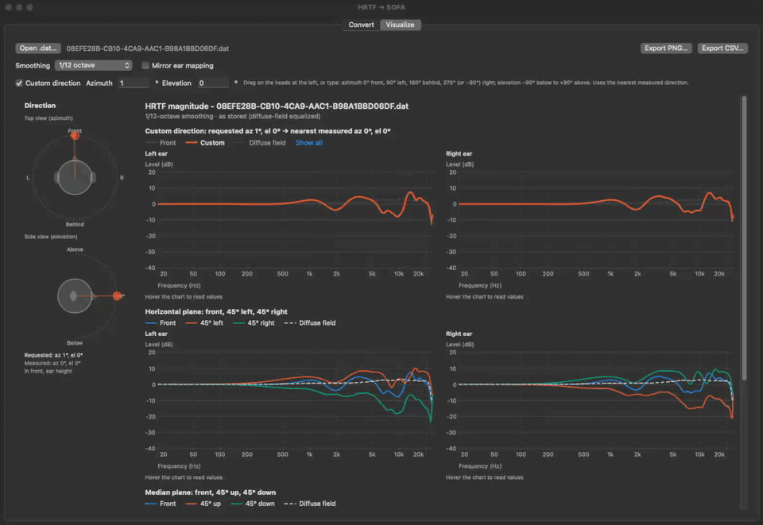

# Apple personalized spatial audio → SOFA

Converts the personalized HRTF that iOS builds from the TrueDepth ear scan
(the `.dat` files synced through iCloud; see below for where to find them) into SOFA
(AES69-2022, `SimpleFreeFieldHRIR` 1.0), so it can be used in any SOFA-aware binaural renderer
or for synthesizing BRIRs.

## Getting your .dat files

The personalized-audio profiles are stored on your Mac at:

```
~/Library/com.apple.bluetooth.services.cloud/CachedRecords/SoundProfileAsset
```

This assumes that:

- your Mac is connected to your iPhone and AirPods, and
- you have set up Personalized Spatial Audio and done the head scan on your iPhone.

Each `<UUID>.dat` file there is one profile. `~/Library` is hidden in Finder, so either use
**Go → Go to Folder…** (⇧⌘G) and paste the path, or copy the files from Terminal:

```bash
mkdir -p ~/hrtf-scans
cp ~/Library/com.apple.bluetooth.services.cloud/CachedRecords/SoundProfileAsset/*.dat ~/hrtf-scans/
```

Work on copies rather than the originals. The files are a biometric description of your head and
ears, so treat them (and the SOFA files made from them) as personal data. This repository's
`.gitignore` excludes `*.dat` and `*.sofa` so they aren't committed by accident.

## Use it

```bash
cd HRTFToSOFA
./build-app.sh                 # -> dist/HRTFToSOFA.app and dist/hrtf2sofa
open dist/HRTFToSOFA.app       # drag .dat files in, press Convert
dist/hrtf2sofa ~/hrtf-scans/*.dat -o ../sofa --listener YourName
```


Needs Xcode or the Command Line Tools. There are no third-party dependencies: the HDF5/netCDF-4
writer is built in (`Sources/HRTFKit/HDF5Writer.swift`).

CLI options: `--keep-delays` (store the ITD in `Data.Delay` instead of baking it in),
`--mirror` (see below), `--distance M`, `--listener NAME`, `--date "Y-m-d H:M:S"`.

`reference/apple_hrtf_to_sofa.py` (Python + numpy) is the reference implementation. The
Swift output matches it byte for byte, apart from floating-point rounding in Data.IR.
`validate.sh [DIR…]` (default `sofa/`) checks every `.sofa` file with libmysofa (`mysofa2json`) and
netCDF (`ncdump`), and writes `validate.log`. It needs `brew install libmysofa netcdf`.

## Visualizer

The app's **Visualize** tab plots the magnitude response at the left and right ears. For each ear there
are two panels:

- **Horizontal plane:** front (az 0°), 45° left (az 45°) and 45° right (az 315°)
- **Median plane:** front, 45° up (el +45°) and 45° down (el −45°)

Each panel also shows the **diffuse field** (dashed). This is the solid-angle-weighted power average over all
2842 directions; each measurement is weighted by its 5° latitude-band area divided by the points in its ring.
The y-axis range is fixed per file and setting, and it covers every measured direction.

- **Highlight a curve:** click a line or its legend entry to highlight it and gray out the others. Click it
  again, click empty space, or use **Show all** to reset.
- **Read values:** hover for a crosshair, synced across both ears, with a value readout.
- **Smoothing** goes from none to 1/3 octave, and the plots export as PNG and CSV.
- `hrtf2sofa … --plot DIR [--smoothing N] [--custom AZ,EL]` writes the same plots and CSVs from the
  command line.

- The curves are shown as stored. The data is **diffuse-field equalized**, so the diffuse-field curve is
  within about 0–3 dB of flat and the directional curves show each direction relative to it.
- The file's metadata also has a per-ear `CTF` (2 × 64 values in dB at k × 375 Hz) that looks like the
  removed diffuse-field response. It is nearly identical across people (see
  [How personal is Apple's personalized HRTF?](#how-personal-is-apples-personalized-hrtf)), so the app
  doesn't use it and doesn't export a diffuse-field HRTF.
- `reference/analyze_hrtf.py` is the reference for these curves. The Swift curves match it to within 0.0001 dB.


### Direction picker

To see any other direction, drag around the **top view** of the head to set the azimuth, and along the
**side view** arc to set the elevation, or type both values. A **Custom direction** panel at the top updates
live while you drag. It shows the nearest measured direction (a hollow ring in the picker) next to the
requested one, plus a plain-language description such as "behind, right, below". Azimuth uses the SOFA
convention: 0° is front, 90° left, 180° behind and 270° (or −90°) right.



## What's in the .dat

Top level is a binary plist:

| key | contents |
|---|---|
| `HRIR_DFEQ` | **used**: minimum-phase HRIRs plus a per-ear fractional delay (the ITD) |
| `HRIR_ITDMod` | same magnitude responses, phase-aligned (peak at ~48 samples), ITD removed (delays all 0) |
| `EQ`, `device`, `version` | export metadata (EQ is an identity gain filter) |

Each HRIR blob: `u32 n`, an `n`-byte bplist of metadata (`SampleRate` 48000, `FilterLength` 128,
`NumChannels` 2, `TotalNumCoordinates` 2842, `FilterScaleFactor`, `CoefficientFormat` int16,
`DelayFormat` float32, a `TriangulationData` interpolation mesh, a 128-value `CTF`), followed by
2842 little-endian records of 528 bytes:

```
f32 elevation_deg   f32 azimuth_deg
128 x i16 taps (ch0)   f32 delay_samples (ch0)
128 x i16 taps (ch1)   f32 delay_samples (ch1)
```

Grid: elevation -90…+90 in 5° steps, with up to 120 azimuths per ring. Taps × `FilterScaleFactor` = IR.
At most about 34 samples (0.7 ms) of ITD. Four scans of one head tested during development were very
consistent (IR correlation ≈ 0.986, delays within ≈ 0.17 samples RMS).

## Conversion choices

- **Ears / azimuth.** The file doesn't label its channels. Channel 0 is the far ear for Apple azimuths
  0–180°, so with the usual L,R channel order Apple's azimuth runs clockwise (90° = right). SOFA
  azimuth runs counter-clockwise, so `az_sofa = 360 − az_apple`, with ch0 → left and ch1 → right.
  `--mirror` uses the other consistent reading (ch1 = left, azimuth unchanged). Localization is
  correct either way; the two differ only in which of your real ears' responses goes on which side.
  Elevation is positive up, which matches more 5–10 kHz energy above than below.
- **ITD.** By default the fractional delay is baked into `Data.IR`: a 32-tap Kaiser-windowed sinc
  (β = 8) plus a common 16-sample pre-delay so no pre-ringing is cut. The result is 256 taps. Magnitude
  error is under 0.002 dB up to 19 kHz, and `Data.Delay` is 0. This is the safest choice for BRIR
  tools, since many ignore `Data.Delay`. With `--keep-delays`, the original 128-tap
  minimum-phase filters are kept and the delays go in `Data.Delay` (M×R).
- Source distance is unknown, so it is set to 1 m. ListenerView/Up and ReceiverPosition use the SOFA defaults.

## libmysofa compatibility notes (learned the hard way)

- Every string attribute must be ≤ 64 bytes; libmysofa rejects larger datatypes. Long values are truncated.
- Group links must use dense storage (fractal heap + v2 B-tree). Compact link messages are rejected.
- Object header v2 only. No float-typed attributes.

## How personal is Apple's personalized HRTF?

Comparing four scans of one head, a profile from a second person, and Apple's generic
HRTF that ships with macOS (`HRIR_General.ir` in AudioDSP.component) suggests that
Personalized Spatial Audio makes real but modest changes. Both personalized profiles sit
about 3 dB RMS from Apple's generic head, but they move away from it in nearly the same
way (deviations ~87% correlated), so most of each profile is a common base head. The
individual part on top of that base is about 1 dB RMS. That's only slightly more than the
~1.3 dB that repeat scans of the same head differ by. The clearest repeatable individual
features are the first pinna notch moving in frequency (consistently 1.5–2.5 kHz higher for
one listener than the other across all scans) and head-size-dependent ITD (~8% different
between the two). For comparison, an unrelated third-party HRTF dataset differs from these
profiles by ~4.6 dB RMS. That suggests the per-person variation in Apple's profiles is
smaller than real head-to-head differences, but the datasets were measured differently and
only two people were compared.

The stored HRIRs are diffuse-field equalized, so they carry no absolute diffuse-field
response. The only absolute curve in the file is the 64-point CTF, and it's nearly
identical across people, scans and phones (within ~1.5 dB). Apple's generic HRTFs on macOS
are diffuse-field equalized too and have no CTF at all. That's why this tool doesn't export a
diffuse-field HRTF: it would effectively be a population curve, not a personal one. A
personal diffuse-field or eardrum target needs a real measurement, such as an audiologist's
real-ear (REUR/REUG) measurement or in-ear microphones. For BRIR use this matters less:
tools like ASH Toolset diffuse-field-calibrate each dataset anyway, so what reaches the
BRIR is exactly the personal directional and timing part described above.
